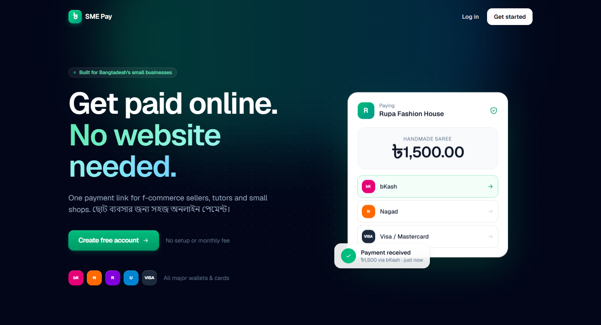
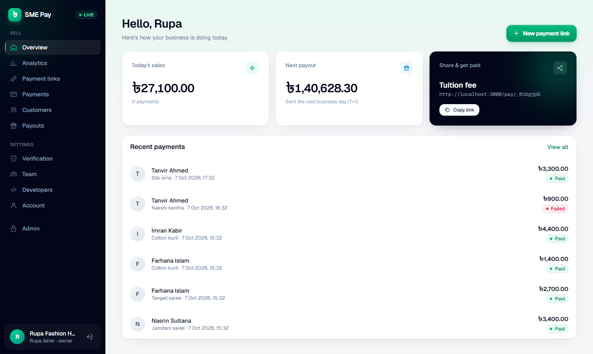
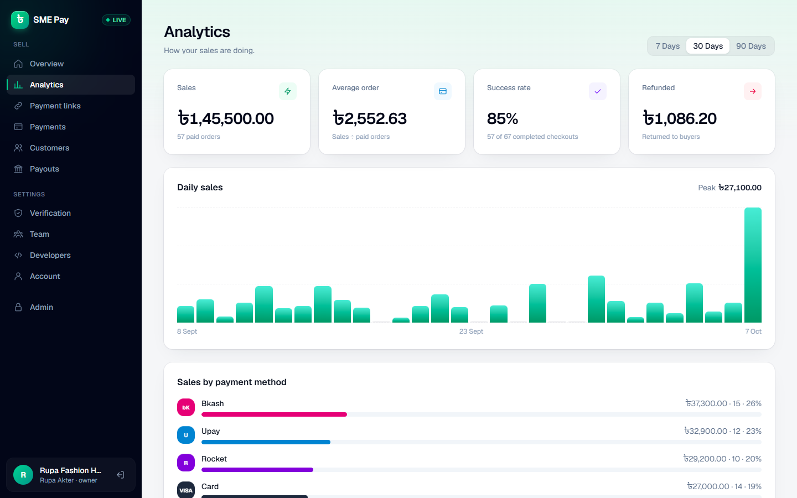
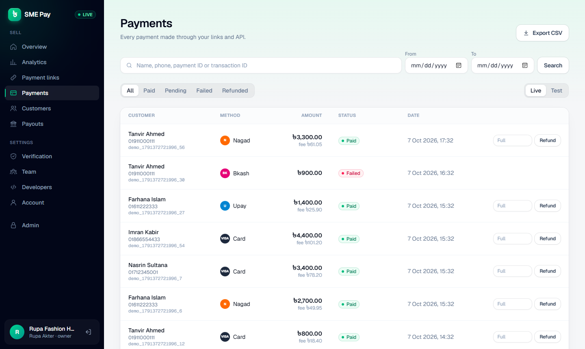
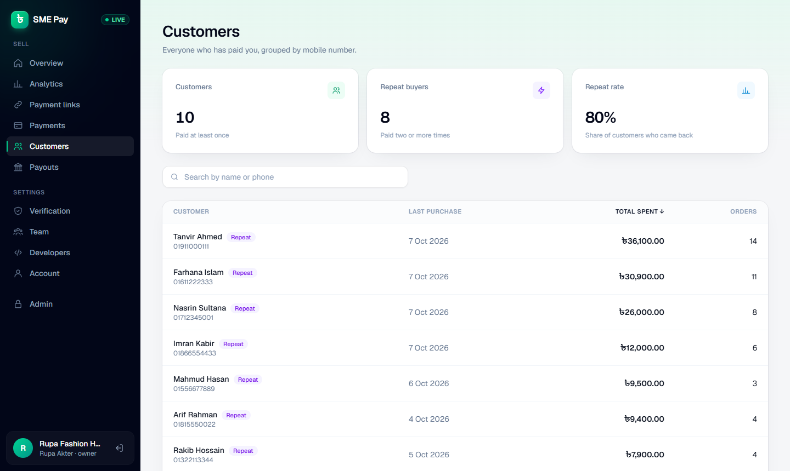
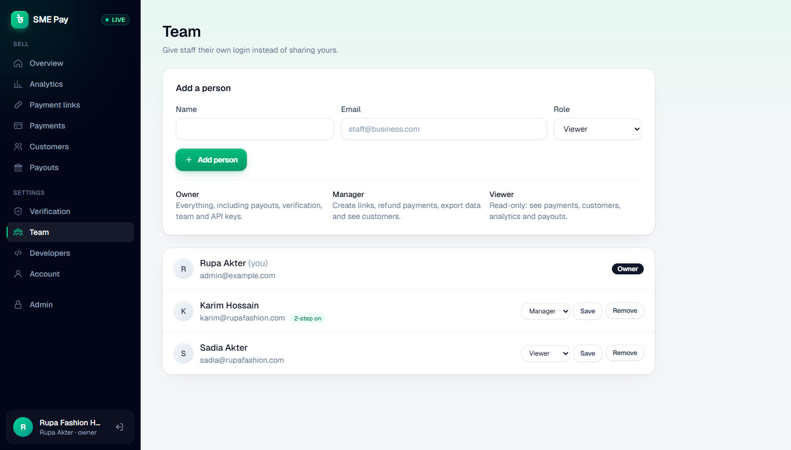
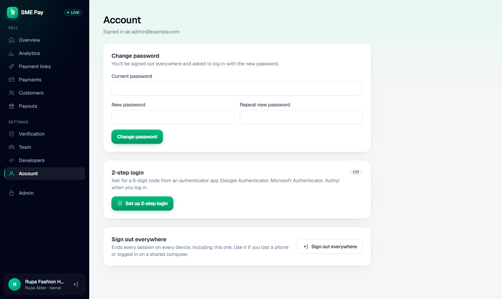
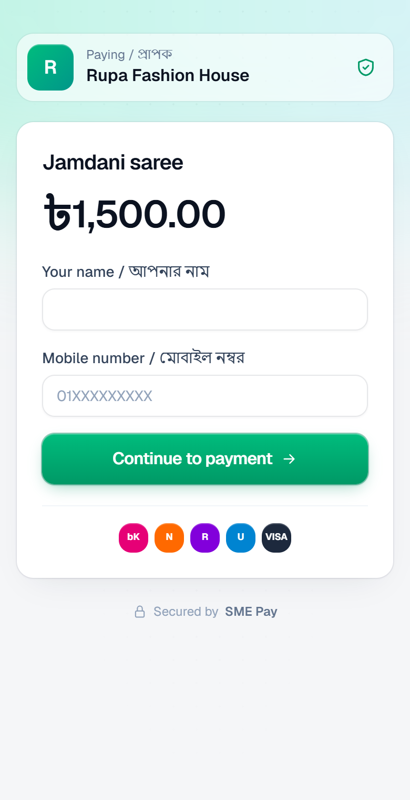
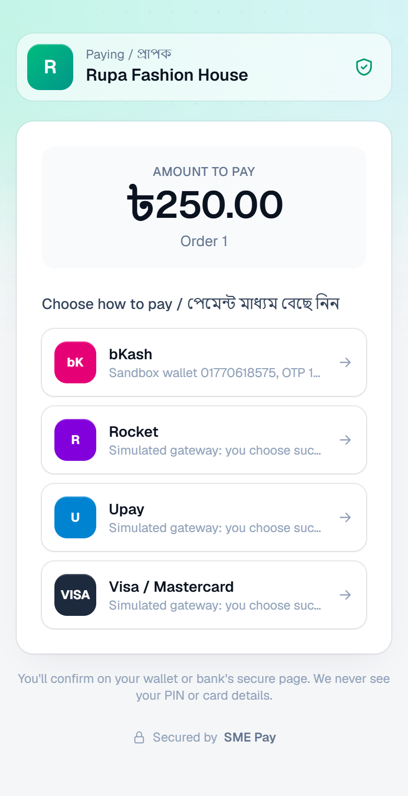
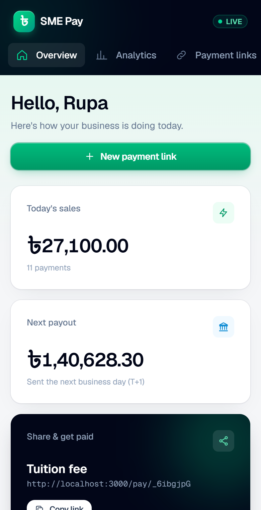

<div align="center">

# ৳ SME Pay

**Payment links, hosted checkout and a REST API for small businesses in Bangladesh.**
<br />
Accept bKash, Nagad, Rocket, Upay and cards with one link. No website needed.




</div>

> [!NOTE]
> This is a **sandbox MVP**. bKash runs against the public Tokenized Checkout sandbox, Nagad needs sandbox credentials from Nagad, and card, Rocket and Upay use a built-in simulator. Processing real money requires a Bangladesh Bank PSO license (see [Going live](#going-live)).

## Contents

- [Features](#features)
- [Buyer experience](#buyer-experience)
- [Payment methods](#payment-methods)
- [Tech stack](#tech-stack)
- [Getting started](#getting-started)
- [Configuration](#configuration)
- [Team roles](#team-roles)
- [REST API](#rest-api)
- [Webhooks](#webhooks)
- [Security model](#security-model)
- [Project structure](#project-structure)
- [Going live](#going-live)

## Features

### Merchant dashboard

Today's sales, the next payout and a one-tap "copy link" card, with recent payments below.



### Sales analytics

A daily sales chart for the last 7, 30 or 90 days (Asia/Dhaka time), sales by payment method, success rate, average order value and refunds.



### Payments: search, filters, refunds and CSV export

- Search by customer name, phone, payment ID or provider transaction ID.
- Filter by status, date range and live/test mode, 50 per page.
- Full or partial refunds in one click.
- Export exactly the filtered rows to CSV; cells are protected against spreadsheet formula injection.



### Customers

Buyers grouped by mobile number, with total spent (after refunds), order count, last purchase and repeat-buyer badges. Click a customer to see their payments.



### Team accounts

Give staff their own login instead of sharing yours. New members get a one-time temporary password and must choose their own on first login. See [Team roles](#team-roles).



### Account security

Change password, sign out on every device, and optional 2-step login with any authenticator app (Google Authenticator, Microsoft Authenticator, Authy).



### Also included

- **Payment links**: a fixed price, or let the buyer enter the amount. Share by copy, WhatsApp or SMS, and pause a link at any time.
- **Verification (KYC)**: payout account plus document upload (PDF, JPG or PNG, checked by file signature). Admin approval switches the merchant to live mode.
- **Next-day payouts (T+1)**: daily settlement with a downloadable CSV statement for every payout.
- **Developers page**: test and live API keys, webhook URL and signing secret.
- **Admin panel**: approve KYC, review documents, mark payouts as paid.

## Buyer experience

A mobile-first, bilingual (English / বাংলা) checkout. Buyers confirm on their wallet's own page, so SME Pay never sees a PIN or card number.

<table>
  <tr>
    <td align="center"><br /><sub><b>1. Open the link</b></sub></td>
    <td align="center"><br /><sub><b>2. Choose how to pay</b></sub></td>
    <td align="center"><br /><sub><b>3. Merchant sees it instantly</b></sub></td>
  </tr>
</table>

## Payment methods

| Method | Fee | Integration |
| --- | --- | --- |
| bKash | 1.85% | Tokenized Checkout (public sandbox) |
| Nagad | 1.85% | Remote Payment Gateway (sandbox credentials from Nagad) |
| Rocket | 1.85% | Simulator |
| Upay | 1.85% | Simulator |
| Visa / Mastercard | 2.30% | Simulator |

Test-mode payments can only use sandbox providers. In production, live payments can never use the simulator or a provider sandbox.

## Tech stack

- **[Next.js 16](https://nextjs.org)** (App Router, Server Actions, Turbopack) with **React 19**
- **[Prisma 7](https://www.prisma.io)** on **PostgreSQL** via the `pg` driver adapter
- **[NextAuth](https://next-auth.js.org)** credentials login with JWT sessions
- **[Tailwind CSS 4](https://tailwindcss.com)**, no UI library
- **[Zod 4](https://zod.dev)** for validation
- Node's built-in `crypto` for password hashing (scrypt), TOTP, AES-GCM and HMAC, with no extra crypto dependencies

## Getting started

**Prerequisites:** Node.js 20.9+ and Docker (for Postgres).

```bash
git clone <your-repo-url> sme-pay && cd sme-pay

docker compose up -d          # Postgres on localhost:5434
cp .env.example .env          # then set NEXTAUTH_SECRET and CRON_SECRET (32+ random characters each)
npm install                   # also runs prisma generate
npx prisma migrate deploy
npm run dev                   # http://localhost:3000
```

1. Open http://localhost:3000, **sign up** and create a payment link. Test payments work right away.
2. Make yourself an admin from the server shell (admin can never be granted through the web UI):

   ```bash
   npm run create-admin -- you@example.com
   ```

3. Open `/admin`, approve your own KYC, and your links switch to live mode.

Run settlement daily after midnight Asia/Dhaka, for example from cron:

```bash
curl -X POST -H "Authorization: Bearer $CRON_SECRET" http://localhost:3000/api/cron/settle
```

### Scripts

| Command | What it does |
| --- | --- |
| `npm run dev` | Start the dev server |
| `npm run build` / `npm start` | Production build and server |
| `npm test` | Core checks: money, ledger, state machine, settlement, webhooks, SSRF guard, TOTP, search filters |
| `npm run lint` | ESLint |
| `npm run create-admin -- <email>` | Grant admin to an existing login |

## Configuration

All settings live in `.env` (see [`.env.example`](.env.example)).

| Variable | Required | Description |
| --- | --- | --- |
| `DATABASE_URL` | Yes | Postgres connection string |
| `APP_URL` | Yes | Public base URL for checkout links and provider callbacks (must be `https` in production) |
| `NEXTAUTH_URL` | Yes | Same as `APP_URL` |
| `NEXTAUTH_SECRET` | Yes | Session signing key, at least 32 characters. Also encrypts 2-step login secrets, so rotating it turns 2-step login off for everyone |
| `CRON_SECRET` | Yes | Bearer token for `/api/cron/settle`, at least 32 characters |
| `BKASH_BASE_URL`, `BKASH_APP_KEY`, `BKASH_APP_SECRET`, `BKASH_USERNAME`, `BKASH_PASSWORD` | For bKash | Tokenized Checkout credentials (the example file has the public sandbox ones) |
| `NAGAD_BASE_URL`, `NAGAD_MERCHANT_ID`, `NAGAD_MERCHANT_NUMBER`, `NAGAD_MERCHANT_PRIVATE_KEY`, `NAGAD_PG_PUBLIC_KEY` | For Nagad | Leave empty to hide Nagad |
| `ENABLE_MOCK_PROVIDERS` | No | `true` shows the simulated card, Rocket and Upay methods |

## Team roles

Each merchant has exactly one **Owner** (created at signup) and up to 20 people in total. Roles are enforced on the server in every page, server action and export, not just hidden in the UI.

| | Owner | Manager | Viewer |
| --- | :---: | :---: | :---: |
| Overview, analytics, payments, customers, payouts | ✅ | ✅ | ✅ |
| Create and pause payment links | ✅ | ✅ | |
| Refund payments | ✅ | ✅ | |
| Export payments to CSV | ✅ | ✅ | |
| Verification and payout account | ✅ | | |
| Team management | ✅ | | |
| API keys and webhooks | ✅ | | |

## REST API

Authenticate with an API key from **Dashboard → Developers**. `sk_test_…` keys create test payments; `sk_live_…` keys (available after KYC approval) create live ones. Amounts are integers in **paisa** (৳1 = 100).

| Method | Endpoint | Description |
| --- | --- | --- |
| `POST` | `/api/v1/payments` | Create a payment and get a `checkout_url` |
| `GET` | `/api/v1/payments?id=&limit=` | List payments (newest first, limit 1–100) |
| `POST` | `/api/v1/payments/{id}/refund` | Refund in full, or partially with `{ "amount": … }` |
| `POST` | `/api/v1/links` | Create a payment link |
| `GET` | `/api/v1/links` | List payment links |

```bash
curl -X POST http://localhost:3000/api/v1/payments \
  -H "Authorization: Bearer sk_test_..." \
  -H "Content-Type: application/json" \
  -H "Idempotency-Key: order-1001" \
  -d '{
    "amount": 150000,
    "description": "Order #1001",
    "customer_name": "Tanvir Ahmed",
    "customer_phone": "01911000111",
    "redirect_url": "https://myshop.com/thanks"
  }'
```

```json
{
  "id": "fmg7a7g24j0w1jtrgj3tv50l",
  "status": "CREATED",
  "mode": "test",
  "amount": 150000,
  "fee": 0,
  "refunded_amount": 0,
  "currency": "BDT",
  "provider": null,
  "description": "Order #1001",
  "customer_name": "Tanvir Ahmed",
  "customer_phone": "01911000111",
  "checkout_url": "http://localhost:3000/checkout/fmg7a7g24j0w1jtrgj3tv50l",
  "paid_at": null,
  "created_at": "2026-10-07T09:14:00.000Z"
}
```

Send the buyer to `checkout_url`. Retrying with the same `Idempotency-Key` returns the original payment; reusing it with different parameters returns `409`. Unknown fields are rejected with `400`, and requests are rate limited (`429`).

## Webhooks

Set a webhook URL on the Developers page to receive `payment.succeeded`, `payment.failed`, `payment.refunded` and `payment.updated` events:

```json
{ "event": "payment.succeeded", "data": { "id": "…", "status": "SUCCEEDED", "amount": 150000, "…": "…" } }
```

Every request carries an `X-SmePay-Signature: t=<unix>,v1=<hex>` header, where `v1` is `HMAC-SHA256(webhook_secret, "<t>.<raw body>")`. Verify it before trusting the payload:

```js
import { createHmac, timingSafeEqual } from "node:crypto";

function verify(rawBody, header, secret, toleranceSec = 300) {
  const { t, v1 } = Object.fromEntries(header.split(",").map((p) => p.split("=")));
  const expected = createHmac("sha256", secret).update(`${t}.${rawBody}`).digest("hex");
  const fresh = Math.abs(Date.now() / 1000 - Number(t)) < toleranceSec;
  return fresh && v1?.length === expected.length && timingSafeEqual(Buffer.from(v1), Buffer.from(expected));
}
```

Failed deliveries are retried, up to 5 attempts in total.

## Security model

- Money moves only on the provider's server-side status (exact amount, currency and order reference); buyer redirects and callbacks are only hints.
- Test payments can only use sandbox providers; in production, live payments can never use the simulator or a provider sandbox.
- Integer paisa everywhere. The double-entry ledger is append-only and balanced per transaction, enforced by database triggers and CHECK constraints.
- Refunds are serialised per merchant, limited to the unsettled balance, and reserved in the ledger before the provider is called. A provider timeout keeps the refund on hold (and pauses that merchant's settlement) for manual reconciliation.
- Payout account changes need the current password; each settlement stores the payout destination it was created with.
- Each person has their own login with a role (see [Team roles](#team-roles)), checked in every page and server action.
- Changing a password or "sign out everywhere" bumps a per-user token version, revoking every existing session. Staff start with a one-time temporary password they must replace.
- Optional 2-step login (authenticator app, RFC 6238). Secrets are AES-256-GCM encrypted with a key derived from `NEXTAUTH_SECRET`, and each code works only once.
- Passwords are hashed with scrypt; unknown emails take the same time to reject, and login is rate limited per IP and per email.
- API keys are stored as SHA-256 hashes; idempotency keys are per mode and reject reuse with different parameters (409).
- Webhooks are HMAC-signed; in production, delivery is refused to private, loopback or metadata IPs.
- Strict security headers (CSP, HSTS in production, `X-Frame-Options: DENY`, no-store on the API). Uploaded KYC files are served as sandboxed downloads only.
- Rate limits are in-memory per process and key on `x-real-ip` or the last `x-forwarded-for` hop, so deploy behind a reverse proxy that sets them.

## Project structure

```text
app/
  page.tsx                 Landing page
  login/, signup/          Auth (split-screen layout)
  dashboard/               Merchant app: overview, analytics, links, payments,
                           customers, payouts, verification, team, developers, account
  admin/                   KYC approval and payouts
  pay/, checkout/          Buyer-facing payment pages
  mock-gateway/            Simulated provider for card / Rocket / Upay
  api/v1/                  REST API
  api/webhooks/[provider]  Provider callbacks
  api/cron/settle          Daily settlement
  styles.ts, ui.tsx        Shared design system
lib/
  payments.ts              Payment lifecycle, refunds, search filters
  ledger.ts                Double-entry ledger
  settlement.ts            T+1 settlement and CSV statements
  providers/               bKash, Nagad and simulator adapters
  auth.ts, totp.ts         Login, sessions, roles, 2-step login
  webhooks.ts              Signed delivery with SSRF protection
  __tests__/core.test.ts   Core checks (npm test)
prisma/
  schema.prisma            Data model
  migrations/              SQL migrations, including ledger triggers and constraints
```

## Going live

The code is not the blocker. Production needs a Bangladesh Bank **PSO license**, a trust-cum-settlement account, provider contracts (a bKash/Nagad aggregator agreement and an acquiring bank for cards), **PCI-DSS** certification and hosting inside Bangladesh.

<div align="center">
<sub>Built for f-commerce sellers, tutors and small shops across Bangladesh.</sub>
</div>
